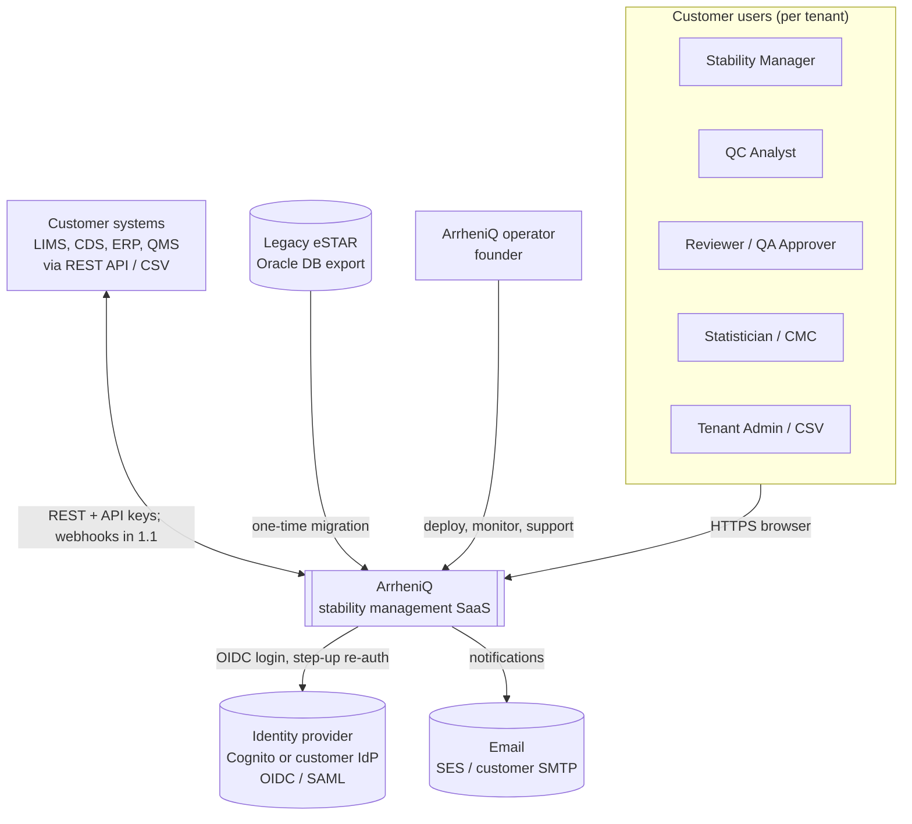
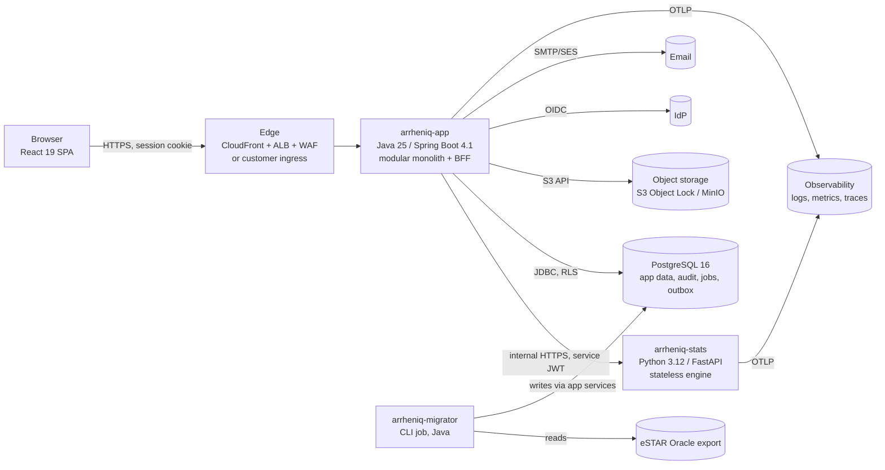
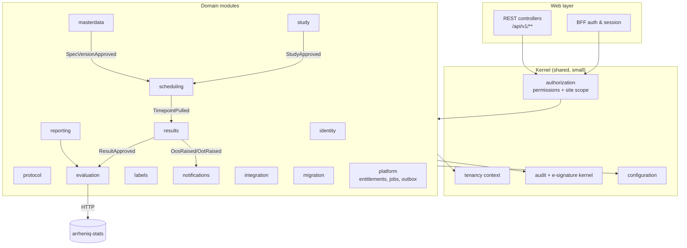

# Architecture Overview

## 1. System context (C4 level 1)


## 2. Containers (C4 level 2)


| Container | Responsibility | Tech | Scales by |
|---|---|---|---|
| **arrheniq-web** (static) | SPA: screens, grids, charts | React 19, TypeScript, Vite, TanStack Query/Router, AG Grid Community, ECharts | CDN |
| **arrheniq-app** | All business logic, BFF (OIDC login, session), REST API, audit/e-sign kernel, reports (PDF/XLSX/DOCX), jobs | Java 25, Spring Boot 4.1, Spring Modulith, Spring Security, Spring Data JPA (Hibernate), JdbcClient, Flyway, db-scheduler, OpenHTMLtoPDF, Apache POI | Horizontal (stateless; sessions in DB) |
| **arrheniq-stats** | Regression, poolability, shelf life, summary stats, OOT methods, Arrhenius/ASAP (1.1); renders report charts (SVG) | Python 3.12, FastAPI, NumPy, SciPy, statsmodels, matplotlib (SVG) | Horizontal (stateless, CPU-bound) |
| **arrheniq-migrator** | eSTAR → ArrheniQ migration, reconciliation report | Java CLI reusing app modules; Oracle JDBC | One-off job |
| **PostgreSQL 16** | System of record, audit store, job queue, outbox, sessions | RDS (cloud) / any PG16 | Vertical; read replica later |
| **Object storage** | Attachments, generated reports, audit anchors, exports | S3 + Object Lock (compliance mode) / MinIO | Managed |

## 3. Components inside arrheniq-app (C4 level 3)
Modules follow the bounded contexts (see bounded-contexts.md). Spring Modulith verifies module boundaries in tests, and modules talk to each other only through published APIs and domain events.



Layering inside each module (enforced by ArchUnit):
`api` (REST DTOs, controllers) → `application` (commands/queries, transactions, authorization, audit) → `domain` (aggregates, invariants, pure Java) → `infrastructure` (JPA repositories, SQL read models, adapters).

## 4. Key request flows

### 4.1 GxP write (e.g., approve a result)
```mermaid
sequenceDiagram
    participant U as Browser
    participant A as arrheniq-app
    participant I as IdP
    participant D as PostgreSQL
    U->>A: POST /api/v1/results/{id}/approve (session cookie + CSRF)
    A->>A: authenticate session, resolve tenant + permissions + site scope
    A->>U: 409 SIGNATURE_REQUIRED (signing intent id)
    U->>I: authorize?prompt=login&max_age=0 (popup)
    I-->>A: callback with ID token (auth_time)
    A->>A: verify sub, auth_time >= intent time, nonce
    A->>D: BEGIN; SET LOCAL app.tenant_id, app.user_id, app.audit_ctx
    A->>D: update result version, insert signature, insert audit_event (hash-chained), insert outbox event
    A->>D: COMMIT
    A-->>U: 200 (signed, version n)
```

### 4.2 Statistics evaluation
1. The app loads approved results (snapshot), spec limits and parameters, then builds an **evaluation request** with a content hash.
2. It calls `POST /v1/engine/{algorithm}@{version}` on arrheniq-stats with a short-lived service JWT.
3. The stats service returns results plus `algorithm_id`, `version`, `input_hash` and warnings. It returns errors for invalid data (never silent defaults).
4. The app stores the evaluation record (inputs snapshot reference + outputs), and the audit kernel records it. The user can sign it.

## 5. Technology stack (versions follow the Spring Boot 4.1 BOM unless noted)
| Area | Choice | ADR |
|---|---|---|
| Language / runtime | Java 25 (LTS), virtual threads enabled | 0001 |
| Framework | Spring Boot 4.1, Spring Modulith, Spring Security (OAuth2 client, session) | 0001, 0006 |
| Persistence | Spring Data JPA (Hibernate) for aggregates; `JdbcClient` SQL for read models and reports; Flyway | 0013 |
| Database | PostgreSQL 16 with RLS | 0003 |
| Jobs / events | db-scheduler (PostgreSQL) + transactional outbox | 0008 |
| Statistics | Python 3.12, FastAPI, NumPy, SciPy, statsmodels | 0002, 0011 |
| Frontend | React 19, TypeScript, Vite, TanStack Query + Router, AG Grid Community, ECharts, react-hook-form + zod | 0006 |
| Reports | Thymeleaf HTML → PDF (OpenHTMLtoPDF, PDF/A-capable); charts as SVG from stats; Apache POI for XLSX/DOCX | 0007 |
| Object storage | S3 API with Object Lock | 0010 |
| Identity | OIDC/SAML; Amazon Cognito (cloud); customer IdP (private) | 0005 |
| Observability | OpenTelemetry (traces, metrics, logs) | 0009 |
| Build / CI | Gradle (Kotlin DSL), pnpm, uv (Python); GitHub Actions | 0014 |
| Testing | JUnit 5, Testcontainers (PostgreSQL, MinIO, Keycloak as a test IdP), ArchUnit, Spring Modulith tests, Playwright, pytest + Hypothesis | 0015 |
| Infrastructure | Terraform (AWS), ECS Fargate; Helm chart + Docker Compose for Private | 0009 |

## 6. Repository layout (monorepo)
```
arrheniq/
├── CLAUDE.md
├── backend/                     # Gradle project: arrheniq-app (+ migrator)
│   ├── app/src/main/java/com/arrheniq/
│   │   ├── kernel/{tenancy,audit,security,config}/
│   │   ├── identity/ masterdata/ protocol/ study/ scheduling/
│   │   ├── results/ evaluation/ reporting/ labels/
│   │   ├── notifications/ integration/ migration/ platform/
│   │   └── ArrheniqApplication.java
│   ├── app/src/main/resources/db/migration/   # Flyway
│   └── migrator/                              # eSTAR migration CLI
├── stats/                       # Python FastAPI engine (uv)
│   ├── arrheniq_stats/{algorithms,api,charts}/
│   └── tests/{reference_data,unit,property}/
├── frontend/                    # React SPA (pnpm)
├── infra/
│   ├── terraform/{modules,envs/{dev,validation,prod}}/
│   ├── helm/arrheniq/
│   └── compose/                 # single-VM private bundle
├── validation/
│   ├── urs.yaml                 # URS as data (generated from docs/product/URS.md)
│   ├── risk/                    # risk assessments per release
│   └── tools/                   # traceability + evidence generators
├── golden/                      # synthetic golden data (private repo or encrypted)
└── docs/{discovery,product,architecture,adr}/
```

## 7. Cross-cutting conventions
- **API:** REST, JSON, `/api/v1`, OpenAPI generated from code. Problem Details (RFC 9457) for errors. Optimistic locking with `If-Match`/version on every GxP update.
- **IDs:** UUIDv7 internally. Human-readable business keys (study ID, spec number) per tenant.
- **Time:** `timestamptz` in UTC for instants. `date` + site time zone for calendar dates such as pull dates (ADR 0012).
- **Numbers:** `numeric` for results, with no floating point in persistence. The stats engine uses float64 internally, with documented tolerances.
- **Errors:** fail closed; no swallowed exceptions (enforced by an ArchUnit/static rule).
- **Requirement tags:** tests carry `@Requirement("URS-xxx-nnn")` (Java) or `@pytest.mark.urs("URS-…")` (Python) to build the traceability matrix.
