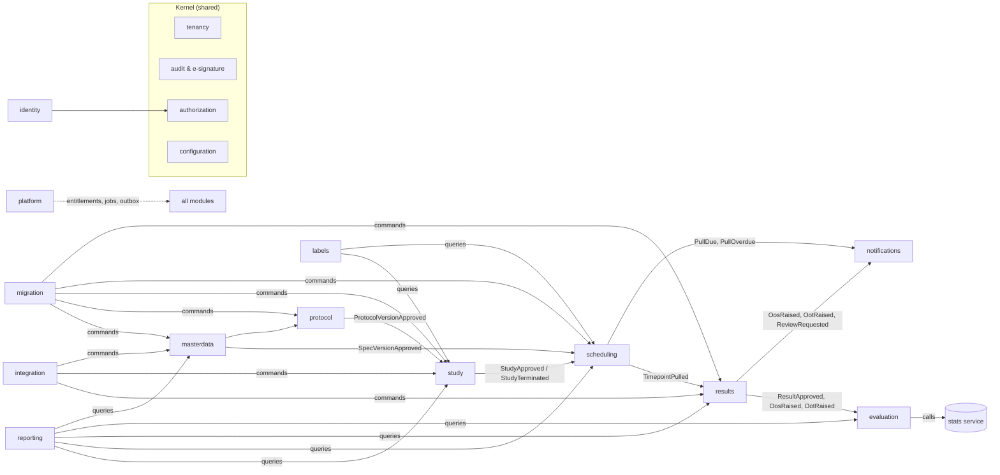

# Bounded Contexts (modules of arrheniq-app)

Each module is a top-level package `com.arrheniq.<module>` and a Spring Modulith application module. A module exposes **(a)** an application API (Java interfaces in `<module>.api`), **(b)** REST endpoints, and **(c)** published domain events. Other modules may use only those. Internal packages are inaccessible, and Modulith verification fails the build otherwise.

## 1. Context map

Rule: **commands flow down, events flow out.** There are no cyclic dependencies, and Modulith checks enforce this.

## 2. Modules
### Kernel (not a business domain; small and stable)
| Kernel part | Responsibility | Key types |
|---|---|---|
| tenancy | Tenant/site context per request and job; sets PostgreSQL session variables; tenant-aware ID generators | `TenantContext`, `SiteScope`, `TenantAwareJobRunner` |
| audit & e-signature | Audit events (field diffs, reasons), hash chain, signature intents and verification, record version hashing | `AuditService`, `ReasonPolicy`, `SignatureService`, `RecordHasher` |
| authorization | Permission evaluation (role → permissions, per site), method security, data-scope filters | `@RequirePermission`, `PermissionEvaluator` |
| configuration | Tenant settings (approval levels, pull windows, weekend rules, signature points…), versioned and audited | `TenantSettings`, `SettingKey` |

### Domain modules
| Module | Responsibility | Aggregates (roots) | Publishes | Key URS |
|---|---|---|---|---|
| **identity** | Users (mirrored from the IdP), roles, permissions, sites, site assignments, access review | `User`, `Role`, `Site`, `Tenant` | `UserDeactivated`, `RoleChanged` | IAM-*, TEN-001..004 |
| **masterdata** | Test library, products, specifications (versioned, approved), dictionaries, ICH templates, formulations | `Test`, `Product`, `Specification` (with `SpecVersion`), `Dictionary` | `SpecVersionApproved`, `ProductApproved` | MD-* |
| **protocol** | Protocols: time points, test matrix, inventory plan, study type; versioning + approval | `Protocol` (with `ProtocolVersion`) | `ProtocolVersionApproved` | PRO-* |
| **study** | Study login (lot × condition), study IDs, packaging components, raw materials, attachments, back-entry attestation, terminate/complete | `Study`, `StudyGroup` (multi-condition login), `Attachment` | `StudyApproved`, `StudyTerminated`, `StudyCompleted` | STU-* |
| **scheduling** | Pull-date engine (calendar, weekend/holiday rules), time points, pull windows, pulls, reversals, inventory ledger, destruction | `StudySchedule` (time points), `InventoryLedger` | `PullDue`, `PullOverdue`, `TimepointPulled`, `PullReversed` | SCH-*, INV-* |
| **results** | Test placeholders per time point, result entry/import, reportable value computation, OOS/alert/OOT flags, review and approval workflow, investigation links | `TimepointResultSet`, `TestResult` (with replicates), `Investigation` | `ResultSubmitted`, `ResultApproved`, `OosRaised`, `OotRaised` | RES-*, REV-*, OOT-* |
| **evaluation** | Shelf-life evaluations, summary statistics, graphs; calls the stats service; stores versioned, signable evaluation records | `Evaluation` | `EvaluationSigned` | EVA-* |
| **reporting** | Report definitions, generation (PDF/XLSX/DOCX), immutable storage + hash, user column preferences, CTD tables | `GeneratedReport`, `ReportPreference` | `ReportGenerated` | RPT-* |
| **labels** | Label templates (fixed in the MVP), barcode generation, print log | `LabelTemplate`, `LabelPrintJob` | — | LBL-* |
| **notifications** | Email/in-app notifications from events and scheduled checks; user preferences | `Notification` | — | SCH-006, OOT-004 |
| **integration** | CSV/XLSX import (results, master data), API keys, full data export, webhooks (1.1) | `ImportJob`, `ApiKey`, `ExportJob` | — | INT-*, RES-007 |
| **migration** | eSTAR mapping and transformation, reconciliation report (shared by the migrator CLI) | `MigrationRun` | — | MIG-* |
| **platform** | Entitlements (plan, sites, active studies), job scheduler, outbox dispatcher, health/ops endpoints, license file (private) | `Entitlement`, `OutboxEvent` | — | ADM-003, TEN-006..008 |
| **dashboard** (in reporting for the MVP) | "My work" counts and lists | read models only | — | DSH-001 |

## 3. Key invariants owned by each aggregate (examples)
| Aggregate | Invariants |
|---|---|
| `SpecVersion` | Only one *effective* version per product at a time; approved versions are immutable; limits are numeric (or text for text tests); alert limits lie inside spec limits |
| `ProtocolVersion` | Time points are strictly increasing; every matrix cell refers to a test on the linked spec; approved versions are immutable |
| `Study` | Can be approved only with an approved spec version and protocol version; study ID unique per tenant; back-entered time points need an attestation |
| `StudySchedule` | Generated once at approval (atomic with `StudyApproved`); pull date changes need a reason; status transitions follow SCHEDULED → PULLED → IN_TESTING → COMPLETED, or TERMINATED |
| `InventoryLedger` | Append-only entries; balance never negative; extra pulls ≤ available reserve; a reversal references the original entry |
| `TestResult` | Values are structured (numeric + qualifier or text); the reportable value is computed by a versioned algorithm; approved results are locked; enter ≠ approve when segregation of duties is on |
| `Evaluation` | Bound to an input snapshot hash + algorithm version; re-running gives an identical output; signed evaluations are immutable |

## 4. Integration styles between modules
| Style | When | Example |
|---|---|---|
| Synchronous API call (same transaction) | A command needs another module's data to decide | `study` asks `masterdata` for the approved spec version |
| Domain event, handled **in the same transaction** | Strong consistency is required (GxP) | `StudyApproved` → `scheduling` generates the schedule (URS-STU-005 atomicity) |
| Domain event via **outbox**, handled asynchronously | Side effects that can retry | Notifications, webhooks, report pre-generation |
| Read model (SQL view or query) | Lists, dashboards, reports | Pull calendar, review queue |

## 5. Legacy → module mapping
| Legacy area (eSTAR) | ArrheniQ module |
|---|---|
| Stability Maintenance (dictionaries, test library, products, approvals) | masterdata |
| Product protocols (`EA_PRD_PROTOCOLS*`) | protocol |
| Login New Studies | study |
| Log Manipulation (scheduler, pulls, extras, restore) + `pkg_ea_schedule` | scheduling |
| Data Entry (entry, L1/final approval, approved data edit, CDS/destruction) | results (+ scheduling for destruction) |
| Data Access Evaluation (graphs, regression, OOS/OOT) | evaluation + results |
| Print modules (reports, labels) | reporting, labels |
| System Maintenance (users, groups, locations, audit, alerts, license) | identity, kernel/audit, notifications, platform |
