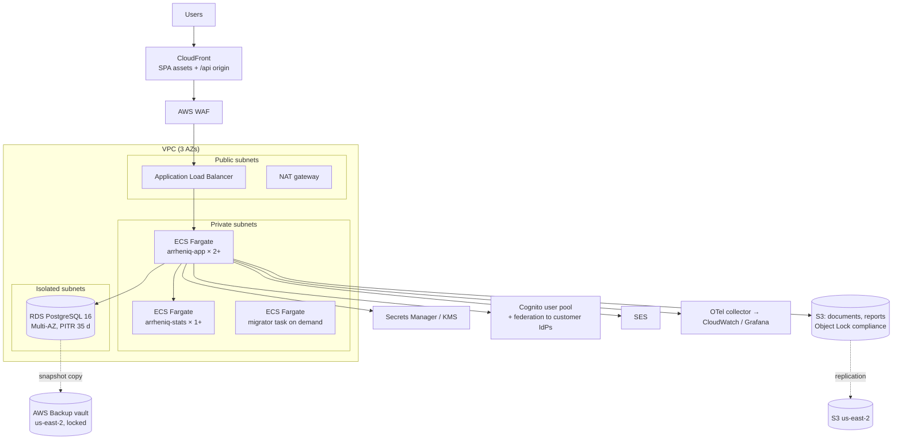
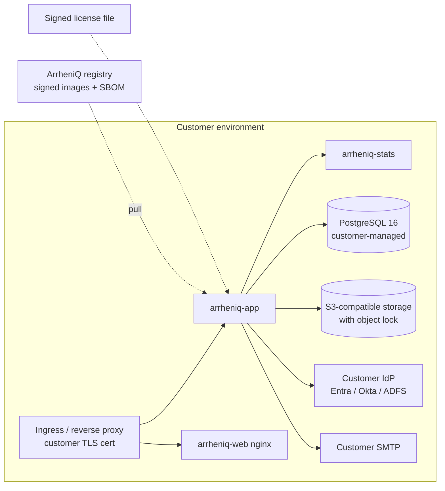
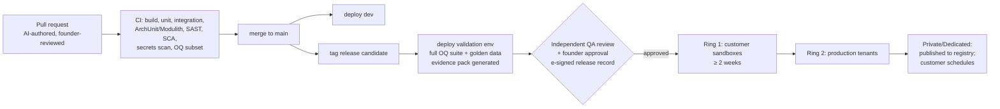

# Deployment Architecture

One set of signed images (`arrheniq-app`, `arrheniq-stats`, `arrheniq-web`, `arrheniq-migrator`) is deployed to three targets (deployment-options.md, ADR 0009).

## 1. ArrheniQ Cloud (MVP), AWS us-east-1 (primary) / us-east-2 (backup copies)

Notes:
- **VPC endpoints** for S3, Secrets Manager, ECR and CloudWatch reduce NAT traffic and keep data off the internet.
- **Stats service** isn't reachable from outside the VPC. The app calls it through ECS Service Connect (internal), authenticated with a service JWT.
- **One shared environment per stage**, with tenants inside it. Enterprise "Dedicated" uses the same Terraform module in a separate AWS account.

## 2. ArrheniQ Dedicated (1.1)
The same Terraform root module, instantiated in a **separate AWS account per customer** (AWS Organizations), with a customer-specific KMS key (optional BYOK), its own Cognito pool or direct customer IdP, and its own RDS instance. It's operated by ArrheniQ through the same pipelines. Upgrades follow the customer's chosen window.

## 3. ArrheniQ Private (1.1)

| Variant | Packaging | For |
|---|---|---|
| Kubernetes (EKS/AKS/on-prem K8s) | Helm chart `arrheniq` + values schema; external PostgreSQL and S3 | Mid/large IT teams |
| AWS account without K8s | Terraform module (ECS Fargate variant) run by the customer | AWS-centric customers |
| Single VM | Docker Compose bundle (app, stats, web, MinIO; PostgreSQL external or bundled) | Small sites, ≤ 300 active studies |

Private installs: **no outbound calls required**. Telemetry is opt-in. The license is verified offline. Air-gapped installs work through an image bundle tarball.

## 4. Environments
| Environment | Purpose | Data | Deployed from |
|---|---|---|---|
| `local` | Development (Docker Compose: PG, MinIO, Keycloak test IdP, stats) | Synthetic | Developer machine |
| `ci` | Ephemeral, per pull request (Testcontainers) | Synthetic | GitHub Actions |
| `dev` (AWS) | Integration, demos | Synthetic + demo tenant | `main` branch, continuous |
| `validation` (AWS) | Release-candidate OQ runs; customer sandbox tenants; vendor validation evidence | Synthetic + customer sandbox data | Release tag (RC) |
| `prod` (AWS) | Customer production | Customer data | Approved release tag |

Validation and prod are **identical in configuration** (same Terraform module, different variables). That's the basis for IQ.

## 5. CI/CD and release flow

- **Images:** built once per release and signed (cosign). SBOM (CycloneDX) attached. The same digest is promoted through every environment.
- **Database migrations:** Flyway, forward-only, expand/contract pattern so deployments need no downtime. Every migration is tested against a copy of the previous release's schema with synthetic data.
- **Rollback:** redeploy the previous image (schema stays compatible through expand/contract). A data restore is a DR event.
- **Release cadence:** monthly minor releases; patch releases for security or critical defects (with expedited QA review).

## 6. Backup and disaster recovery
| Item | Cloud / Dedicated | Private |
|---|---|---|
| Database | RDS PITR (35 days) + daily snapshots copied to a locked AWS Backup vault in us-east-2 (retained 1 year) | Customer's responsibility; runbook provided |
| Objects | S3 versioning + Object Lock + cross-region replication | Customer's responsibility |
| Audit anchors | Daily digest to an Object Lock bucket (compliance mode, 15 years) | Same pattern on customer storage |
| RPO / RTO | ≤ 15 min / ≤ 4 h (URS-NFR-003) | Customer-defined |
| DR test | Twice a year: restore to the us-east-2 recovery stack; recorded | Template test protocol provided |
