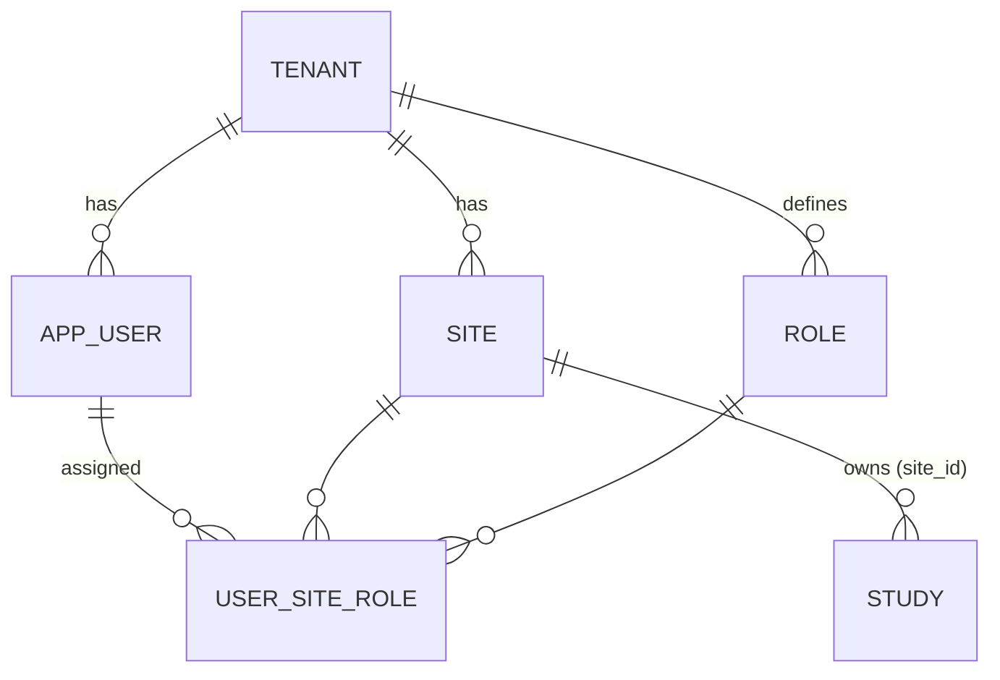

# Multi-Tenancy Design

**Decision:** shared database, shared schema, `tenant_id` on every tenant-owned row, enforced by **PostgreSQL Row-Level Security (RLS)** and by the application (ADR 0003). Dedicated and Private deployments run the same code with a single tenant.

## 1. Model

- **Tenant** = a customer organization (a contract). It's the isolation boundary.
- **Site** = a location inside a tenant. It's an *authorization scope*, not an isolation boundary (URS-TEN-002).
- **CRO clients** (1.1) are modelled as a **client** dimension on products/studies within the CRO's tenant, with client-viewer roles scoped to client IDs.

## 2. Tenant resolution
| Entry point | How the tenant is determined |
|---|---|
| Browser (BFF session) | The user logs in at `https://<tenant-slug>.arrheniq.com` → the slug selects the Cognito app client / IdP connection → on callback the user is matched to `(tenant_id, idp_subject)` → the session stores `tenant_id`, `user_id` and site assignments. **A tenant can't be switched within a session.** |
| API key (integration) | The key's hash maps to `(tenant_id, api_key_id, scopes)` |
| Background job | The job row carries `tenant_id`; `TenantAwareJobRunner` sets the context before running |
| Stats service | Receives no tenant data except the evaluation payload; stateless; no DB access |
| Private / Dedicated | Single tenant; same mechanism (`tenant_id` constant) |

## 3. Enforcement in PostgreSQL
Every tenant-owned table:
```sql
CREATE TABLE study (
    tenant_id   uuid        NOT NULL,
    id          uuid        NOT NULL,          -- UUIDv7
    site_id     uuid        NOT NULL,
    study_code  text        NOT NULL,          -- e.g. 260041
    ...
    version     bigint      NOT NULL DEFAULT 0,
    PRIMARY KEY (tenant_id, id),
    UNIQUE (tenant_id, study_code),
    FOREIGN KEY (tenant_id, site_id) REFERENCES site (tenant_id, id)
);

ALTER TABLE study ENABLE ROW LEVEL SECURITY;
ALTER TABLE study FORCE ROW LEVEL SECURITY;          -- applies to the table owner too

CREATE POLICY tenant_isolation ON study
    USING      (tenant_id = current_setting('app.tenant_id')::uuid)
    WITH CHECK (tenant_id = current_setting('app.tenant_id')::uuid);
```
Rules:
1. **Composite keys** `(tenant_id, id)` and **composite foreign keys**, so a row can't reference another tenant's row even by bug.
2. The application connects as role `arrheniq_app`: **not** a superuser, **no** `BYPASSRLS`, not the table owner. Schema migrations run as `arrheniq_owner` (Flyway only).
3. The tenant context is set **per transaction** with `SELECT set_config('app.tenant_id', :tenant, true)` (transaction-local). It's safe with connection pooling because it resets at commit or rollback.
4. If `app.tenant_id` isn't set, `current_setting` raises an error, so queries **fail closed**.
5. Platform-level tables (tenants, plans, job definitions) live in the schema `platform` and are accessible only to the `arrheniq_platform` role used by operator tooling.
6. Study IDs and other business sequences are **per tenant** (row in `tenant_sequence (tenant_id, name, year, next_value)` updated with `SELECT … FOR UPDATE`), and are concurrency-safe (URS-STU-002).

## 4. Enforcement in the application (defence in depth)
- `TenantContext` is required by every repository. A Hibernate `@TenantId` discriminator adds `tenant_id` automatically on insert and query.
- An ArchUnit rule: no repository or `JdbcClient` call outside the `infrastructure` packages; all SQL goes through tenant-aware helpers.
- **Site scope:** queries add `site_id = ANY(:allowedSites)` through a scope filter. RLS handles the tenant; the app handles the site (site membership changes too often to be pure RLS).

## 5. Provisioning and lifecycle
| Step | Action |
|---|---|
| Create tenant | Operator CLI/console → `platform.tenant` row, Cognito app client/branding, default roles, ICH templates, default settings, first admin invitation. Audited in the platform audit log |
| Sandbox tenant | Same, flagged `sandbox = true`; banner in the UI; "SANDBOX" watermark on reports |
| Suspend | Login blocked; data kept |
| Export (exit) | Full export job (CSV/JSON + documents + audit trail) to a signed, time-limited S3 URL (URS-INT-003) |
| Delete | Only after contract end + confirmation + export; crypto-shredding of tenant documents (per-tenant data key); DB rows deleted by the platform role; deletion certificate generated |

## 6. Noisy-neighbour protection
- Per-tenant rate limits (API and imports) in the app, with WAF rate rules at the edge.
- Heavy work (reports, imports, evaluations) runs as **jobs** with per-tenant concurrency limits.
- Statement timeout for interactive queries (e.g., 15 s); report jobs have a longer budget.
- Monitoring: per-tenant request, job and DB-time metrics (OpenTelemetry attribute `tenant.id`, never in logs as PII).

## 7. Isolation testing (part of OQ)
1. **Automated cross-tenant suite:** for every REST endpoint, create data in tenant A, then call as tenant B. Expect 404/403 and no data in the response. Generated from the OpenAPI spec so new endpoints are covered automatically (URS-TEN-001).
2. **SQL-level test:** connect as `arrheniq_app` without a tenant set. Every select on every tenant table must fail.
3. **Schema linter (CI):** every table in the `app` schema has `tenant_id`, RLS enabled + forced, a policy, and a composite PK. The build fails otherwise.
4. External penetration test includes tenant-isolation attempts.
