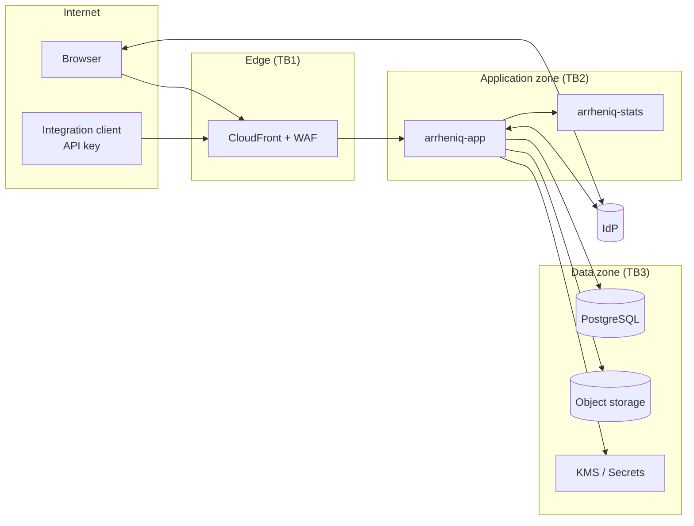

# Security Architecture

Target: OWASP ASVS Level 2 (URS-SEC-005), SOC 2 readiness, and no repeat of any legacy finding (S-01..S-15).

## 1. Trust boundaries

## 2. Threat model (STRIDE)
| # | Threat | Where | Control(s) | Verified by |
|---|---|---|---|---|
| T1 | **Spoofing** a user (stolen credentials) | Login | IdP with MFA; lockout; no passwords in the app; session cookie `HttpOnly; Secure; SameSite=Lax`; session rotation on login | Pen test; config review |
| T2 | Spoofing a signer (someone signs at an unattended session) | E-signature | Re-authentication per signature (`max_age=0`, `auth_time` check); idle lock (URS-IAM-004) | OQ tests (audit-esignature §10) |
| T3 | Spoofing an internal service | app → stats | Stats reachable only inside the VPC; short-lived service JWT (signed by the app, audience `stats`) | Network test; unit test |
| T4 | **Tampering** with GxP data via the API | REST | Authorization on every endpoint (deny by default); optimistic locking; validation; audit trail | Endpoint auth test suite (generated) |
| T5 | Tampering with the audit trail | DB | INSERT-only role; trigger guard; hash chain; daily anchors in Object Lock | OQ tamper test |
| T6 | Tampering through injection (SQL, template, CSV formula) | App | Parameterized queries only (lint rule); output encoding; Thymeleaf escaping; CSV export prefixes cells starting with `= + - @` | SAST (Semgrep rules); tests |
| T7 | **Repudiation** of an approval | Signatures | Signature bound to the record hash; auth_time + IdP evidence; audit event | OQ |
| T8 | **Information disclosure** across tenants | All | RLS + composite keys + app filters + cross-tenant test suite | multi-tenancy §7 |
| T9 | Information disclosure via files | Uploads/downloads | Server-generated object keys; presigned URLs (≤ 5 min) after authorization; `Content-Disposition: attachment`; malware scan | Tests; pen test |
| T10 | Information disclosure via logs/errors | Logs | Structured logging without PII or secrets; Problem Details without stack traces; log redaction filter | Log review; tests |
| T11 | Session theft (XSS/CSRF) | Browser | BFF (no tokens in the browser); CSP (`default-src 'self'`, no inline script); CSRF token (double-submit) on state-changing requests; React auto-escaping; Trusted Types where supported | DAST (ZAP); pen test |
| T12 | **Denial of service** | Edge/App | WAF rate rules; per-tenant rate limits; upload size limits; statement timeouts; jobs with quotas | Load test |
| T13 | **Elevation of privilege** (user → admin, site A → site B) | App | Permission model with site scope; admin actions need specific permissions + audit; SoD rules; no "god mode" for tenant admins over GxP approvals | Authorization test matrix |
| T14 | Operator/insider access to customer data | Ops | No standing production DB access; break-glass role with MFA, time-limited and audited; every access logged and reported to the customer on request | Access review; SOC 2 |
| T15 | Supply-chain compromise | Build | Pinned dependencies; SCA gate; signed images (cosign); SBOM; dependency review in PRs; minimal base images (distroless) | CI evidence |
| T16 | Deserialization attacks (legacy S-12 pattern) | App | No Java native serialization; JSON only, with explicit DTOs and no polymorphic typing from untrusted input | SAST rule |
| T17 | AI-generated insecure code | Dev process | Founder review; SAST/SCA/secret scanning on every PR; security tests generated per endpoint; external pen test | CI + pen test |

## 3. Authentication and session design (ADR 0005, 0006)
- **Browser:** Spring Security OAuth2 Login (authorization code + PKCE) against the tenant's IdP connection. Tokens stay server-side, and the browser only gets a session cookie. Sessions are stored in PostgreSQL (Spring Session JDBC), so app instances stay stateless.
- **Idle timeout / lock** per tenant settings (URS-IAM-004), enforced server-side; the UI shows the lock screen.
- **API clients:** tenant-scoped API keys (random 256-bit, stored as an Argon2id hash, prefix shown for identification). Each has scopes (permissions) and a site scope, and can expire and be rotated. They can't sign records. OAuth2 client credentials come in 1.1.
- **Lockout:** handled by the IdP (Cognito advanced security or customer IdP policy). The app records login events into the audit trail from IdP callbacks.

## 4. Authorization model
- **Permissions** are fine-grained strings, e.g. `study.create`, `study.approve`, `result.enter`, `result.approve.l1`, `result.approve.final`, `audit.view`, `config.manage`.
- **Roles** are tenant-defined bundles of permissions, with presets from URS-IAM-006.
- **Assignment** = (user, role, site) or (user, role, ALL_SITES).
- **Evaluation:** `@RequirePermission("result.approve.final")` on the application service, plus a `SiteScope` check on the target record's site, plus domain rules (SoD, state).
- **Deny by default:** a controller method without an explicit permission annotation fails the build (ArchUnit). The generated endpoint security test calls every endpoint with no session, a wrong tenant and a missing permission.

## 5. Data protection
| Data | At rest | In transit | Keys |
|---|---|---|---|
| PostgreSQL | RDS encryption (AES-256, KMS) | TLS (require SSL; verify-full) | AWS KMS CMK per environment; per-customer CMK for Dedicated |
| Documents/reports | S3 SSE-KMS + per-tenant data key (envelope) for crypto-shredding | TLS | KMS |
| Backups | Encrypted, separate locked vault | — | Separate KMS key |
| Secrets | AWS Secrets Manager, rotated (DB credentials monthly) | — | KMS |
| Private installs | Customer's choice; documentation requires encryption at rest | TLS required | Customer |

## 6. Secure SDLC (one founder + AI)
| Stage | Control | Tool (proposal) |
|---|---|---|
| Coding | Secure-coding rules in `CLAUDE.md`; architecture tests | ArchUnit, Spring Modulith |
| PR | SAST; secrets scan; SCA; license check; Semgrep custom rules (no string SQL, no `@PermitAll` on API) | Semgrep, gitleaks, OWASP Dependency-Check or GitHub Dependabot, Trivy |
| Build | SBOM; image scan; sign | Syft/CycloneDX, Trivy, cosign |
| Test | Endpoint authorization suite; cross-tenant suite; DAST baseline on dev | ZAP baseline |
| Release | Independent QA review; release risk assessment includes security changes | — |
| Yearly | External pen test; SOC 2 audit (from year 2) | External firm |
| Ongoing | Dependency updates weekly; critical CVE patch SLA ≤ 7 days (cloud), advisory to Private customers ≤ 7 days | Renovate |

## 7. Logging, monitoring and incident response
- **Security events** (logins, failures, lockouts, permission changes, API key use, signature failures, export of data) go to the audit trail **and** to the security log stream.
- **Alerts:** repeated auth failures, cross-tenant denial spikes, audit-chain verification failure, unusual export volume, admin role grants.
- **Incident response plan:** severity levels; customer notification ≤ 72 h for confirmed incidents affecting their data (or sooner if the contract requires); post-incident review. The founder is on call; a contracted DevOps partner is the backup (mvp-scope risk register).

## 8. Legacy findings → ArrheniQ controls
| Legacy | ArrheniQ control |
|---|---|
| S-01/S-04/S-11 unauthenticated services/servlets | §4 deny-by-default + generated endpoint auth tests |
| S-02/S-05 path traversal (read/delete/write) | T9: server-generated keys, presigned URLs, no filesystem paths |
| S-03/S-06 SQL injection | T6: parameterized only; Semgrep rule fails the build |
| S-07/S-14 secrets in config/DB, DES | §5 Secrets Manager/KMS; no app-stored passwords (URS-SEC-003) |
| S-08 cleartext | TLS everywhere, HSTS |
| S-09/S-10 weak password handling | IdP-managed; no passwords in the app |
| S-12 vulnerable libraries / deserialization | T15/T16 |
| S-13 swallowed exceptions | Static rule (no empty catch); fail closed |
| S-15 repo hygiene | gitleaks pre-commit + CI; `.gitignore` for build outputs |
