# CI/CD Plan (GitHub Actions)

Implements the release flow in `docs/architecture/deployment-architecture.md` §5 step by step. Stages **C1–C4** exist now and cover everything produced in Phases 1–4. Stages **C5–C12** are added as later phases create the code they test or deploy.

## 1. What runs today
| Stage | Workflow | Trigger | What it does | Covers |
|---|---|---|---|---|
| **C1** Backend build | `.github/workflows/ci-backend.yml` | PR / push to `main` touching `backend/**` | JDK 25 (Temurin), `mvn -B verify`: compile with `-Werror`, unit tests (ModularityTests, TenantContextTest, migrator parser tests), integration test `ApplicationIT` (Spring Boot + PostgreSQL 16 via Testcontainers); uploads Surefire/Failsafe reports (90 days) | Phase 4 backend skeleton + migrator; ADR 0001, 0017 |
| **C2** Database | `.github/workflows/ci-database.yml` | PR / push touching `db/**` or the script | PostgreSQL 16 service → `scripts/ci/db-tests.sh`: bootstrap roles, apply V1–V12 with psql, schema linter (10 checks), security behaviour tests T01–T21 | Phase 4 schema; URS-TEN-001, URS-AUD-001/003/005, URS-SEC-001; ADR 0003, 0004 |
| **C3** Security | `.github/workflows/security.yml` | Every PR, push to `main`, weekly | gitleaks secret scan over full history; dependency review on PRs (fail on High); CodeQL `security-extended` for Java | security-architecture.md §6 (T15, T17); URS-SEC-005 |
| **C4** Docs | `.github/workflows/docs.yml` | PR / push touching docs or READMEs | Relative-link check for tracked docs (architecture, ADRs, data, backend) | Phase 3 architecture + ADRs |
| — | `.github/dependabot.yml` | Weekly | Maven + GitHub Actions update PRs (Spring and test libraries grouped) | security-architecture.md §6 |
| — | `.github/pull_request_template.md` | Every PR | URS IDs, ADRs, GxP and security checklist | ADR 0015 |

Phases 1 and 2 (discovery, product) are local-only working documents (git-ignored), so they have no CI.

### Verified locally before committing
- `scripts/ci/db-tests.sh` ran end to end against PostgreSQL 16.15: 12 migrations applied, lint OK, all behaviour tests passed.
- All workflow YAML files parse. The link checker passed on the tracked docs (0 errors).
- **Not run yet on GitHub:** first run happens when you push. C1 also needs the Maven build to resolve dependencies (see `backend/README.md`, first-build checklist).

## 2. Pipeline roadmap

```mermaid
flowchart LR
    subgraph Now["Now (Phases 1-4)"]
        C1[C1 backend build + tests]
        C2[C2 database tests]
        C3[C3 security scans]
        C4[C4 docs links]
    end
    subgraph P5["Phase 5"]
        C5[C5 stats service: pytest + R reference parity]
    end
    subgraph P6["Phase 6"]
        C6[C6 frontend: lint, typecheck, unit, Playwright]
        C7[C7 traceability + OQ evidence pack]
        C8[C8 container images: SBOM, Trivy, cosign]
        C9[C9 deploy dev on merge]
    end
    subgraph P7["Phase 7"]
        C10[C10 release candidate → validation env, full OQ]
        C11[C11 release approval: QA + founder e-sign]
        C12[C12 rings: sandboxes → production; registry for Private]
    end
    Now --> P5 --> P6 --> P7
```

| Stage | Added in | Workflow (planned) | Key steps | Gate |
|---|---|---|---|---|
| C5 Stats | Phase 5 | `ci-stats.yml` | uv sync; ruff; mypy; pytest (unit + Hypothesis); reference datasets vs R outputs (tolerance 1e-8); legacy parity (1e-6) | PR blocked on failure |
| C6 Frontend | Phase 6 (S0) | `ci-frontend.yml` | pnpm install; eslint; tsc; vitest; Playwright against `docker compose` (app + stats + PG + Keycloak test IdP) | PR blocked |
| C7 Evidence | Phase 6 (S0) | `oq-evidence.yml` (reusable) | Collect test results with `@Requirement` tags → traceability matrix (URS → test → result) + OQ evidence pack (HTML/PDF) as an artifact; fail if an MVP URS has no passing test | Required for release |
| C8 Images | Phase 6 (S0) | `images.yml` | Build `arrheniq-app`, `arrheniq-stats`, `arrheniq-web`, `arrheniq-migrator` (ARM64); CycloneDX SBOM; Trivy scan (fail on Critical); cosign keyless signing; push to ECR (and GHCR for Private) | Main branch only |
| C9 Deploy dev | Phase 6 (S0) | `deploy-dev.yml` | OIDC → AWS (no long-lived keys); Terraform plan/apply `envs/dev`; ECS deploy by image digest; smoke tests | Automatic on merge |
| C10 Release candidate | Phase 7 | `release-candidate.yml` | On tag `vX.Y.Z-rc.N`: deploy `validation` env (same Terraform module as prod); full OQ suite + golden data parity; DAST (ZAP baseline); evidence pack attached to the GitHub release | Manual tag |
| C11 Release approval | Phase 7 | GitHub Environment `production` with required reviewers | Independent QA reviewer + founder approve; release record (notes, risk assessment, evidence links) signed | 2 approvals |
| C12 Rollout | Phase 7 | `release.yml` | Ring 1 customer sandboxes (≥ 2 weeks) → ring 2 production tenants; publish signed images + Helm chart + Compose bundle for Private/Dedicated | Approved release only |

## 3. Repository settings to configure (one-time, on GitHub)
1. **Branch protection on `main`:** require PRs; require status checks `ci-backend / Maven verify (JDK 25)`, `ci-database / Migrations + RLS/audit tests (PostgreSQL 16)`, `security / Secret scan (gitleaks)`, `security / CodeQL (Java)`, `docs / Relative link check`; require linear history; block force pushes.
2. **Code scanning:** enable GitHub Advanced Security / code scanning results (free for public repos; GitHub Advanced Security licence for private repos. VERIFY your plan).
3. **Dependabot alerts and security updates:** enable.
4. **Actions permissions:** default `GITHUB_TOKEN` read-only; allow only GitHub-authored and verified actions plus `actions/*`, `github/*`.
5. **Pin actions by commit SHA** before production use. Dependabot keeps the pins current.
6. **Environments (later, C9–C12):** `dev`, `validation`, `production` with AWS OIDC roles; required reviewers on `validation` and `production`.

## 4. Conventions
- Workflow names and job names are stable, because branch protection refers to them.
- Every workflow uses least-privilege `permissions:`, `concurrency` to cancel superseded runs, and timeouts.
- Logic lives in versioned scripts (`scripts/ci/*`) so it can be run and debugged locally. Workflows stay thin.
- Test reports and evidence artifacts are retained for 90 days in CI. Released evidence packs are archived permanently with the release (validation record).
