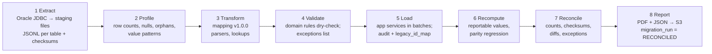

# eSTAR Migration Tool: Design

Requirements: URS-MIG-001..003, URS-EVA-010. Inputs: legacy-mapping.md, golden-data-plan.md (discovery).
Component: `backend/migrator` (Java CLI, `arrheniq-migrator` image). Runs as a one-off job (an ECS task in the cloud, a container in Private).

## 1. Principles
1. **Never write to the legacy database.** The tool reads from a restored copy of the customer's Oracle export.
2. **Load through the application's domain services**, not raw SQL. Migrated data goes through the same validation, audit and RLS paths as native data (with `actor_type = MIGRATION`, `origin = ESTAR_MIGRATION`).
3. **Deterministic and repeatable:** the same input and mapping version give the same output. Dry runs go to a sandbox tenant as often as needed; the production run goes to the production tenant once.
4. **Nothing is silently dropped.** Every source row ends up mapped (`legacy_id_map`), intentionally excluded (listed by rule), or reported as an exception.
5. **Reconciliation is evidence:** the report is a controlled record, reviewed and e-signed by customer QA (URS-MIG-002).

## 2. Pipeline


| Stage | Output | Notes |
|---|---|---|
| 1 Extract | `staging/<run>/<TABLE>.jsonl` + `manifest.json` (row counts, SHA-256 per file) | Read-only JDBC; consistent snapshot (`SET TRANSACTION READ ONLY`) |
| 2 Profile | `profile.json` | Orphans (no FKs in legacy!), duplicate codes, non-numeric limits, unparseable result values, unknown users |
| 3 Transform | In-memory target model per aggregate | Parsers: result values (legacy-mapping §7), expiration period (§3), parameters (§6), module → permission (§9) |
| 4 Validate | `exceptions.json` | Each exception has a severity: BLOCKER (stops a PRODUCTION run), WARNING (needs review), INFO |
| 5 Load | Target rows + `legacy_id_map` + audit events | Order: sites → users/roles → dictionaries → tests → products/specs → protocols → studies → time points → inventory → results → attachments → legacy audit history → approvals (legacy signatures) |
| 6 Recompute | Parity table | Reportable value vs `RESULT_AVERAGE`; legacy-parity regression for each product/test with ≥ 3 points |
| 7 Reconcile | `reconciliation.json` | Per legacy table: source rows, mapped, excluded (rule), exceptions; per target table: rows loaded; checksums of key fields |
| 8 Report | PDF + JSON in S3; `app.migration_run` updated | Signed by customer QA in ArrheniQ |

## 3. Run modes
| Mode | Target | Blockers allowed | Used for |
|---|---|---|---|
| `DRY_RUN` | Sandbox tenant (wiped before each run) | Yes (reported) | Iterating on mapping and data cleanup with the customer |
| `PRODUCTION` | Production tenant (must be empty of studies) | **No**: the run aborts at stage 4 | Cut-over |

## 4. Configuration (`migration.yaml`, versioned with the run)
```yaml
tenantId: 6f1c…           # target tenant
mode: DRY_RUN
source:
  jdbcUrl: jdbc:oracle:thin:@//localhost:1521/XEPDB1
  username: EAPHARMICS_RO   # read-only account on the restored copy
siteTimeZone: America/New_York
sites:                      # legacy LOCATION_ID → site code
  "1": NJ
productTypes:               # optional overrides by product code prefix
  default: DRUG_PRODUCT
users:                      # optional username → email when EMAIL is empty
  jsmith: jane.smith@customer.com
labelTemplateDefault: STD_2D
attachmentsDirectory: /data/estar-uploads   # legacy UploadServlet directory, if available
```

## 5. Exception catalogue (initial)
| Code | Severity | Condition |
|---|---|---|
| MIG-E001 | BLOCKER | Study references a missing product, protocol or condition (orphan) |
| MIG-E002 | BLOCKER | Inventory ledger reconstructs to a negative balance |
| MIG-E003 | WARNING | Result replicate value unparseable (kept as text) |
| MIG-E004 | WARNING | Spec limit non-numeric (kept as text limit) |
| MIG-E005 | WARNING | Expiration period unparseable (set to TO_BE_DETERMINED) |
| MIG-E006 | WARNING | User without email (IdP linking needs manual mapping) |
| MIG-E007 | WARNING | Recomputed reportable value ≠ legacy `RESULT_AVERAGE` (after rounding) |
| MIG-E008 | INFO | Legacy per-user permissions turned into a generated role |
| MIG-E009 | BLOCKER | Duplicate `STUDY_ID` in source |
| MIG-E010 | WARNING | Attachment BLOB empty or file missing |

## 6. Performance target
A typical site (≈ 250 active plus 2,000 historical studies, ≈ 300k result rows) should complete a dry run in **under 60 minutes**. Batches of 500 aggregates per transaction; audit events for migrated data are written in bulk (still chained).

## 7. Testing
- Unit tests for every parser and mapper (the result value parser, expiration parser and parameter mapper are implemented in the skeleton).
- An end-to-end test on the **synthetic eSTAR database** (golden-data-plan, decision D-07): Oracle Free container ← install scripts + scripted studies → migrator DRY_RUN → reconciliation must show 0 blockers and expected counts.
- Tagged `@Requirement("URS-MIG-001")` etc. for the OQ evidence.
