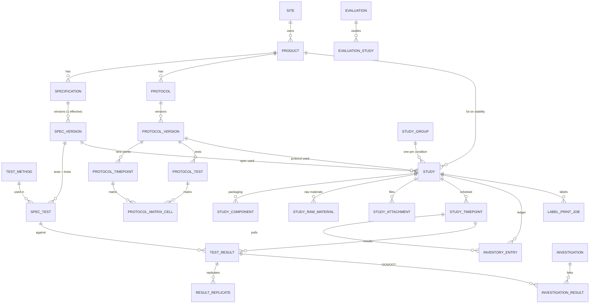

# ArrheniQ Database Schema (v1, Flyway V1–V12)

Source of truth: `backend/app/src/main/resources/db/migration/V*.sql`. This page summarises it.
Verified on PostgreSQL 16 (2026-11-25): all migrations apply cleanly, the schema linter reports 0 violations, and 21 security behaviour tests pass (`backend/app/src/test/resources/db/`).

## 1. Schemas and roles
| Schema | Content | RLS | Runtime access (arrheniq_app) |
|---|---|---|---|
| `app` | 46 tenant-owned business tables | Forced, `tenant_id = app.current_tenant()` | SELECT, INSERT, UPDATE; **no DELETE** on GxP/security tables |
| `audit` | 4 tables: audit events, e-signatures, signature status, anchors | Forced | SELECT, INSERT only; triggers block UPDATE/DELETE/TRUNCATE |
| `platform` | 10 cross-tenant tables: tenants, entitlements, reference catalog, jobs, sessions, classification | None (no tenant data) | Read-only catalog; read/write jobs and sessions |

| Role | Purpose | Notes |
|---|---|---|
| `arrheniq_owner` | Owns objects; runs Flyway | Never used by the running app |
| `arrheniq_app` | Runtime role of arrheniq-app | NOBYPASSRLS, not owner, not superuser (linted) |
| `arrheniq_platform` | Operator tooling | Calls `platform.provision_tenant(...)`; no direct tenant-data access |

## 2. Built-in safety mechanisms
| Mechanism | Where | Proves |
|---|---|---|
| `app.current_tenant()` raises if `app.tenant_id` isn't set | V1 | Queries fail closed (test T10) |
| Forced RLS + `tenant_isolation` policy on every app/audit table | V12 `platform.apply_security()` | Tenant isolation (T11, T13, T20) |
| Composite PK/FK `(tenant_id, id)` everywhere | V3–V9 | No cross-tenant references (T14) |
| `require_audit_context` trigger on all GxP/security tables | V12 | No write without an audit context (T12) |
| DELETE/TRUNCATE revoked on GxP/security tables; logical delete needs `delete_reason` | V12 + common columns | URS-AUD-005 (T16, T17) |
| Audit chain trigger (contiguous `seq`, `prev_hash` = tail hash) + immutability triggers | V9 | URS-AUD-003 (T18, T19) |
| Table classification registry; unclassified tables fail `apply_security()` and the linter | V1, V12 | Every new table is deliberately classified |

**Rule for future migrations:** register every new table in `platform.table_classification` and finish the migration with `SELECT platform.apply_security();`.

## 3. Standard GxP record columns
`tenant_id, id (UUIDv7 from the app), version (optimistic lock), created_at/by, updated_at/by, deleted_at/by, delete_reason, origin (NATIVE | ESTAR_MIGRATION | IMPORT)`, with `PRIMARY KEY (tenant_id, id)` and `CHECK (deleted_at IS NULL OR delete_reason IS NOT NULL)`.

## 4. Core domain ER (simplified)


## 5. Table catalog (generated from the database)
| Table | Class | Columns | Description |
|---|---|---|---|
| `app.api_key` | SECURITY | 19 |  |
| `app.app_user` | SECURITY | 20 | Legacy EA_APP_USER (no passwords stored: URS-SEC-003). Usernames never reused (URS-IAM-001). |
| `app.dictionary` | GXP | 15 | Legacy EA_DICTIONARY_MASTER. |
| `app.dictionary_value` | GXP | 19 | Legacy EA_DICTIONARY_DETAIL (+ EA_DEFAULT_DICTIONARY_DETAIL via catalog). |
| `app.evaluation` | GXP | 25 | Versioned, reproducible statistical evaluations (URS-EVA-005). |
| `app.evaluation_study` | GXP | 13 |  |
| `app.export_job` | GXP | 17 | Data exports, themselves audited (URS-INT-003, AUD-006). |
| `app.generated_report` | GXP | 25 | Immutable generated reports with hash (URS-RPT-005). |
| `app.import_job` | GXP | 20 | CSV/XLSX imports with preview before apply (URS-RES-007). |
| `app.inventory_entry` | GXP | 22 | Append-only inventory ledger (URS-INV-001..006). Replaces legacy UNITS_PULLED/EXTRA_PULLED overwrite + restore. |
| `app.investigation` | GXP | 19 |  |
| `app.investigation_result` | GXP | 13 | Links OOS/OOT results to investigations (URS-OOT-004). |
| `app.label_print_job` | GXP | 18 | Legacy EA_LABEL_PRINT_REQUESTS(+_DETAILS). Print log (URS-LBL-002). |
| `app.label_template` | GXP | 17 | Legacy EA_PRD_LABELS (fixed templates in MVP; designer in 1.1). |
| `app.legacy_id_map` | GXP | 6 | Legacy IDs searchable after migration (URS-MIG-003). |
| `app.migration_run` | GXP | 21 | eSTAR migration runs + reconciliation (URS-MIG-001/002). |
| `app.notification` | NON_GXP | 8 |  |
| `app.outbox_event` | NON_GXP | 10 | Transactional outbox (ADR 0008). |
| `app.product` | GXP | 25 | Legacy EA_PRD_PRODUCTS. URS-MD-002. |
| `app.product_batch_size` | GXP | 14 | Legacy EA_PRD_PRODUCT_BATCHES. |
| `app.product_formulation_line` | GXP | 16 | Legacy EA_PRD_PRODUCT_FORMULATION. URS-MD-008. |
| `app.protocol` | GXP | 14 |  |
| `app.protocol_matrix_cell` | GXP | 14 | Test x time-point matrix (URS-PRO-002); basis for matrixing. |
| `app.protocol_test` | GXP | 14 |  |
| `app.protocol_timepoint` | GXP | 17 | Normalised legacy TEST_INTERVAL_VALUE1..20 (URS-PRO-001/003). |
| `app.protocol_version` | GXP | 20 | Versioned protocol (URS-PRO-005). Legacy protocols had max 20 time points. |
| `app.report_preference` | NON_GXP | 6 |  |
| `app.result_replicate` | GXP | 17 | Normalised legacy RESULT_1..30 (VARCHAR) into structured values (URS-RES-002). |
| `app.role` | SECURITY | 15 | Legacy EA_APP_ACCESS_TEMPLATE (user groups) → permission bundles (URS-IAM-005/006). |
| `app.role_permission` | SECURITY | 13 |  |
| `app.signing_intent` | SECURITY | 12 | Server-side signing intents for re-authentication (audit-esignature.md §9.2). |
| `app.site` | GXP | 18 | Legacy EA_LOCATIONS. Authorisation scope inside a tenant (URS-TEN-002/003). |
| `app.spec_test` | GXP | 28 | Legacy EA_PRD_PRODUCT_TESTS (limits as numeric; were VARCHAR). URS-MD-003. |
| `app.spec_version` | GXP | 18 | Versioned specification (URS-MD-004). One EFFECTIVE version per spec. |
| `app.specification` | GXP | 14 | Stable identity of a product specification; content lives in spec_version. |
| `app.study` | GXP | 45 | Lot x condition on stability. Legacy EA_PRD_PRODUCT_STUDY + EA_PRD_STUDY_CONDITIONS (1:1). URS-STU-001..009. |
| `app.study_attachment` | GXP | 19 | Legacy EA_PRD_STUDY_ATTACHMENTS (BLOB) → object storage (URS-STU-008, SEC-004). |
| `app.study_component` | GXP | 15 | Normalised 20 packaging/site columns of EA_PRD_PRODUCT_STUDY (URS-STU-003). |
| `app.study_group` | GXP | 13 | One study login creating several studies (one per condition) for a lot (URS-STU-004). |
| `app.study_raw_material` | GXP | 16 | Legacy EA_PRD_STUDY_RAW_MATERIALS. |
| `app.study_timepoint` | GXP | 31 | Legacy EA_PRD_STUDY_INTERVALS + EA_PRD_STUDY_SCHEDULES (1:1 in practice). URS-SCH-001..007. |
| `app.tenant_sequence` | NON_GXP | 4 | Per-tenant business sequences, row-locked (URS-STU-002; legacy EA_STUDY_ID_MASTER). |
| `app.tenant_setting` | GXP | 14 | Legacy EA_APPL_PARAMETER (28 parameters, business-rules.md). Versioned + audited (URS-ADM-001/002). |
| `app.test_method` | GXP | 28 | Test library (legacy EA_PRD_TESTS). URS-MD-001. |
| `app.test_result` | GXP | 35 | Legacy EA_PRD_STUDY_TEST_RESULTS (one row per time point x test). URS-RES-*, REV-*. |
| `app.user_site_role` | SECURITY | 16 | Legacy EA_APP_USER_MODULE_ACCESS + EA_APP_USER_LOCATIONS. |
| `audit.audit_anchor` | GXP | 6 | Daily chain anchors, also written to WORM storage (audit-esignature.md §8). |
| `audit.audit_event` | GXP | 21 | Append-only, hash-chained audit trail. hash = SHA-256(canonical(event) // prev_hash). URS-AUD-001..003. |
| `audit.e_signature` | GXP | 16 | Electronic signatures bound to record version + content hash (URS-ESG-001..003). |
| `audit.e_signature_status` | GXP | 6 |  |
| `platform.entitlement` | PLATFORM | 9 | Plan entitlements (packaging-pricing.md; URS-ADM-003). |
| `platform.platform_audit_log` | PLATFORM | 6 | Operator actions (tenant provisioning, suspension, break-glass). |
| `platform.ref_dictionary` | PLATFORM | 6 |  |
| `platform.ref_dictionary_value` | PLATFORM | 6 |  |
| `platform.ref_protocol_template` | PLATFORM | 8 |  |
| `platform.scheduled_tasks` | PLATFORM | 12 |  |
| `platform.spring_session` | PLATFORM | 7 |  |
| `platform.spring_session_attributes` | PLATFORM | 3 |  |
| `platform.table_classification` | PLATFORM | 4 | Data classification per table (audit-esignature.md §2). Drives guards and grants in V900. |
| `platform.tenant` | PLATFORM | 13 | Customer organisation = isolation boundary (multi-tenancy.md §1). |

## 6. How to run the database tests locally
```bash
# PostgreSQL 16 running locally (or docker run postgres:16)
psql -U postgres -v owner_password=o -v app_password=a -v platform_password=p \
     -f backend/app/src/main/resources/db/bootstrap/00_roles_and_database.sql
# apply migrations in version order as arrheniq_owner (Flyway does this in the app build)
for f in $(ls backend/app/src/main/resources/db/migration | sort -t V -k2 -n); do
  psql -U arrheniq_owner -d arrheniq -1 -v ON_ERROR_STOP=1 -f backend/app/src/main/resources/db/migration/$f; done
backend/app/src/test/resources/db/run_db_tests.sh
```
